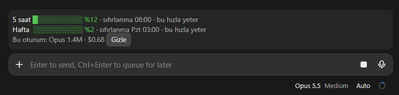

# limit-bar

Claude Code için bir mod. Mesaj kutusunun hemen üstünde, kullanım limitlerini bir bakışta gösteren küçük bir bant çizer.



<sub>Claude masaüstü uygulamasında gerçek görünüm. Renkler ve yazı tipi temanıza göre değişir.</sub>

Bantta şunlar var:

- **5 saatlik** ve **haftalık** limitin doluluk yüzdesi (renkli çubukla: %70 altı yeşil, %70–89 sarı, %90 ve üstü kırmızı)
- Her limitin **sıfırlanma** saati
- **Tahmini bitiş**: şimdiki tüketim hızıyla limitin sıfırlanmadan önce dolup dolmayacağı, dolacaksa ne zaman
- Bu oturumda **model başına** harcanan token (Opus, Sonnet, Haiku…) ve varsa oturum maliyeti

Limit verisi ilk yanıttan sonra gelir; o zamana kadar bant bunu söyler.

## Kurulum

Bir terminal oturumunun komut satırında:

```
/plugin install limit-bar --marketplace alihaber/claude-limit-bar
```

`Add marketplace?` sorusuna `y` deyin, sonra kapsamı seçin (önerilen: user). Kabuktan:

```bash
claude plugin install limit-bar --marketplace alihaber/claude-limit-bar
```

Masaüstü uygulamasında (`/plugin` orada çalışmaz): komut kutusunun yanındaki **+** → **Plugins** → **Add marketplace** ile `alihaber/claude-limit-bar` ekleyin, ardından **Add plugin**.

## Kullanım

- `/limitbar` bandı gizler ya da yeniden gösterir.
- Bandın sağındaki **Gizle** düğmesi de bandı gizler.

Gizli/açık durumu oturum boyunca korunur.

## Lisans

Apache-2.0. Ayrıntılar için `LICENSE` dosyasına bakın.
